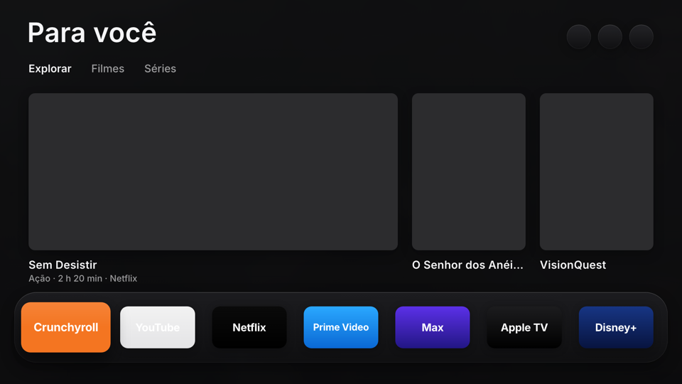

# Free My TV — este fork

Um fork pessoal do **[simbasjungles/free-my-tv](https://github.com/simbasjungles/free-my-tv)**, personalizado para uma
TV LG webOS (uma LG OLED55C1PSA). Para saber o que o projeto em si é, como instalar, e tudo o mais sobre ele, veja
[o repositório original](https://github.com/simbasjungles/free-my-tv) e seu próprio README — este fork não muda nada
disso.

## Instalação: Developer Mode + Free My TV

O passo a passo que seguimos nesta TV (LG, webOS). O [projeto original](https://github.com/simbasjungles/free-my-tv)
documenta isso com mais detalhe, e também para outras TVs (Android TV/Google TV, Samsung) — veja o
[README dele](https://github.com/simbasjungles/free-my-tv#readme) para o que não está resumido aqui.

1. **Developer Mode na TV**: LG Content Store → *Developer Mode* → login com uma conta de desenvolvedor LG (grátis,
   em webostv.developer.lge.com) → *Dev Mode Status* ligado (a TV reinicia) → *Key Server* ligado. A TV passa a
   mostrar o próprio IP e uma senha de uso único.
2. **Configuração** (`config.properties`, criado por `python3 webos/build.py` na primeira vez): preenchemos
   `latitude`/`longitude` e `city` (Brasília, no nosso caso) e colamos nossa própria chave do TMDB (grátis, em
   themoviedb.org) em `tmdb_key`.
3. **Build**: `python3 webos/build.py`, que deve terminar em `Built FreeMyTV-webos.ipk`.
4. **Instalar**: `python3 webos/install.py <IP da TV>`. Na primeira vez ele pede a senha que a TV mostrou no passo 1;
   depois disso guarda uma chave SSH própria para essa TV, e as próximas atualizações não pedem senha de novo.
5. **Abrir**: segurar uma tecla numérica do controle fixa o Free My TV nela (num controle sem teclas numéricas, ele
   fica na lista de apps da LG). O Developer Mode dura cerca de 40 dias — *EXTEND*, dentro do próprio app, renova,
   assim como `python3 webos/renew.py <IP>` pelo computador que fez a instalação.

A partir daí entramos no que é específico deste fork — os ícones, a correção de performance e o root — descrito
abaixo.

## O que é diferente aqui

Tudo abaixo é específico deste fork e desta TV; nada disso é comportamento do projeto original.

- **Os ícones da prateleira** de alguns apps (Netflix, YouTube, Crunchyroll, Stremio) foram substituídos ou
  adicionados, já que o ícone que a própria TV informava para alguns deles não carregava. Veja
  [`web/icons/SOURCES.md`](web/icons/SOURCES.md) para saber de onde cada um veio e por quê.
- **Uma correção de performance** (`web/tv.js`): TVs LG que informam 2 GB de memória agora recebem o mesmo modo de
  renderização sem sombras ("flat") que TVs Samsung com essa memória já tinham — sem isso, a prateleira visivelmente
  perdia quadros ao mover o cursor por ela.
- **A configuração desta TV** (`config.properties`, não versionado): ordem dos apps na prateleira, cidade e chave do
  TMDB.

Além disso, esta TV está **com root** (por conta e risco do próprio dono, sem relação com o Free My TV em si) para
algumas personalizações a mais, cada uma documentada em seu próprio arquivo:

- [`webos/rooting-slopbro.md`](webos/rooting-slopbro.md) — como fazer root na TV, com
  [SlopBro](https://github.com/throwaway96/slopbro).
- [`webos/root-autostart.md`](webos/root-autostart.md) — um script que abre o Free My TV sozinho, em todo reboot de
  verdade e toda vez que a TV acorda do modo de espera.
- [`webos/magic-mapper-buttons.md`](webos/magic-mapper-buttons.md) — remapear o botão **Home** do controle para abrir
  o Free My TV diretamente, com o botão **vermelho** como reserva para o launcher da própria LG, usando o
  [andrewfraley/magic_mapper](https://github.com/andrewfraley/magic_mapper).

## Licença

MIT, igual ao projeto original — veja [`LICENSE`](LICENSE).
